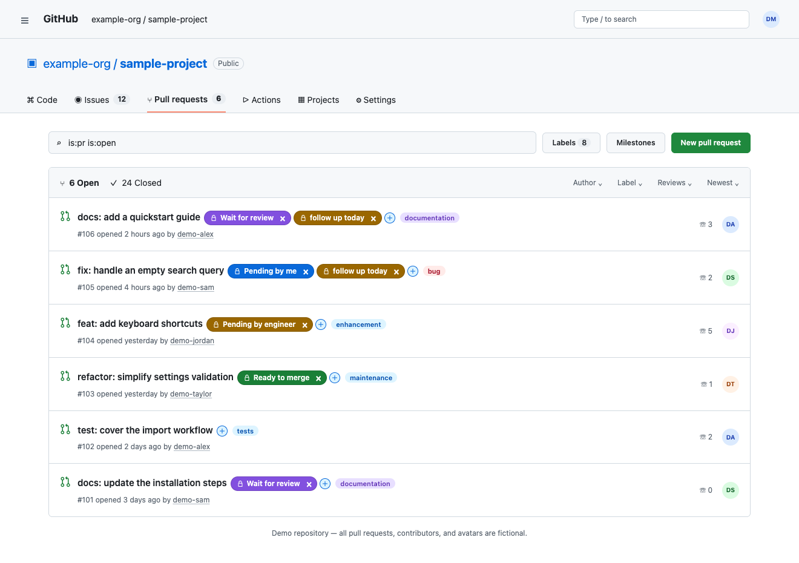
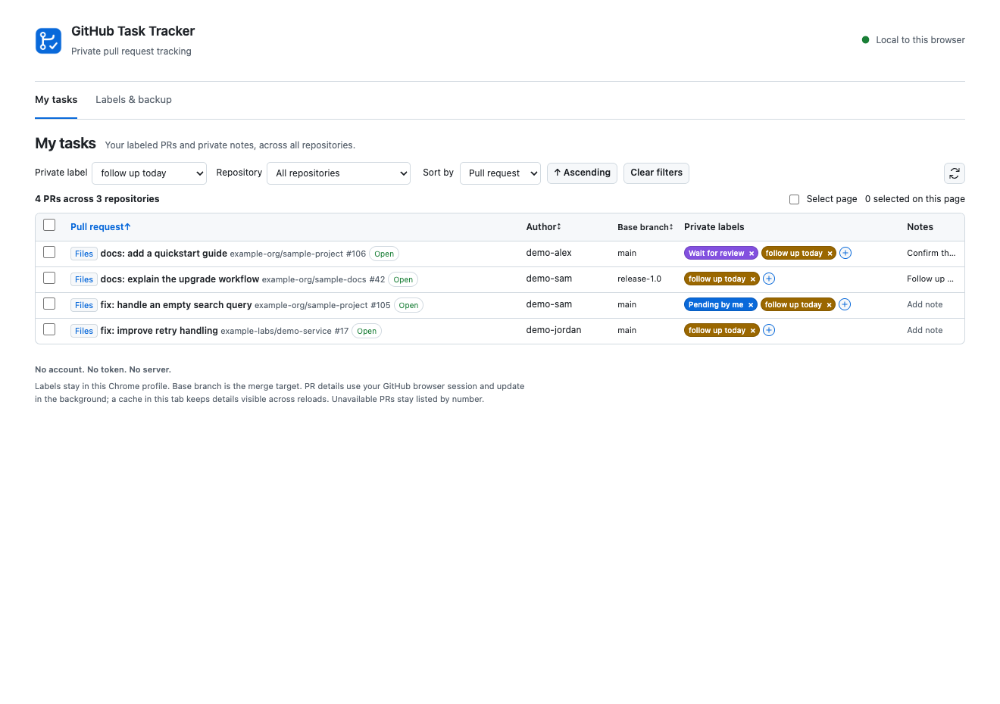

# GitHub Task Tracker

A Chrome extension for tracking pull requests with private labels and notes. Add labels such as **Wait for review** or **Ready to merge** directly on GitHub, then find your tracked PRs across repositories in **My tasks**.

Your labels and notes stay in your browser. No GitHub token, backend, or cloud sync is required, and the extension does not change a repository's public labels.



## Install

Requires Chrome 120 or later. No build or `npm install` is needed.

1. Download or clone this repository to a permanent folder.
2. Open `chrome://extensions` and enable **Developer mode**.
3. Click **Load unpacked** and select the folder containing `manifest.json`.
4. Refresh any open GitHub tabs.

Keep the folder in place. After updating the source, click **Reload** on the extension's card, then refresh your GitHub tabs. Reload the existing extension to preserve your data; uninstalling removes it.

## Use

1. **Label a PR.** On a GitHub PR list, click **+** beside a PR title. On a PR's **Conversation** page, use **Private labels** below **Labels** in the sidebar. Select labels or choose **+ Create label**. Changes on GitHub save immediately.
2. **Find your PRs.** Click the extension's toolbar icon to open **My tasks**. Filter by label or repository, sort the list, and click a title to open the PR or **Files** to review its changes.
3. **Keep a note.** In My tasks, click **Add note**, enter your text, and click **Save note**.

Click **×** beside a label to remove it from a PR. To rename labels, change colors, or back up your data, open **Labels & backup** from My tasks.



## More ways to work

- **Filter on GitHub:** click a private label to show matching PRs on the current GitHub page. Clear the filter to show all rows again. Other pages may contain more matches; GitHub's counts and bulk actions still include hidden rows.
- **Edit labels in My tasks:** click **+** on a row, or select PRs and click the **Private labels** column header. Check labels to add them, uncheck to remove them, then click **Apply labels**. Untouched labels keep their assignments. Selection applies only to the current page.
- **Reorder labels:** drag a label's six-dot handle in a picker, or focus the handle and press **Alt + ↑ / ↓**. The order is shared across pickers.
- **Update PR details:** click **Refresh** in My tasks. Unavailable PRs remain listed with a retry option.

PRs stay tracked after they close or merge. Removing the last label removes a PR from My tasks, even if it has a note. The note is kept and reappears if you label the PR again. Notes support up to 2,000 characters each.

Supported pages are repository PR lists, personal PR lists (including assigned, mentioned, and review-requested), and PR **Conversation** pages with a Labels sidebar on `github.com`. GitHub Enterprise domains and the **Files changed**, **Commits**, and **Checks** tabs do not have label controls.

## Backup and restore

Open **Labels & backup** and click **Export JSON** to save your labels, assignments, label order, and notes.

To restore, choose **Import JSON**, review the preview, and click **Replace current data**. **Import replaces your current data**, so export a backup first if you want to keep it. Invalid files leave current data unchanged.

Backups support up to 100 labels and 10,000 PR records, with a maximum import size of 5 MB.

## Privacy and storage

Labels and notes are stored locally in your Chrome profile and are not uploaded. They persist across browser restarts but are removed when you uninstall the extension. All GitHub accounts used in one Chrome profile share the same data.

My tasks reads PR details from GitHub using your browser session. It caches those details separately from your labels and notes; the cache is not included in backups.

Local data and exported backups are not encrypted by the extension. Private labels and notes can appear in screenshots or be seen by anyone with access to your screen or browser profile. See the [privacy policy](PRIVACY.md) for details.

## Development

The extension uses Manifest V3 and plain JavaScript, with no runtime dependencies. Node.js 20 or later is needed for checks and packaging; packaging also requires the system `zip` command.

```sh
npm test          # Run data, messaging, and storage regression tests
npm run check     # Check the manifest, assets, and JavaScript syntax
npm run package   # Create dist/github-task-tracker-0.1.0.zip
```

### Browser tests and screenshots

Browser tests use Playwright, a temporary Chrome profile, and local GitHub fixtures. No signed-in account is required.

```sh
npm install --no-save --package-lock=false playwright
npx playwright install chromium
npm run test:browser
```

To reuse an existing installation, set `GTT_PLAYWRIGHT_MODULE` to its absolute module path and `GTT_CHROME_EXECUTABLE` to a Chrome for Testing executable. Test screenshots are saved to `test-results/`.

Run `npm run screenshots` with the same setup to regenerate the README images. These use fictional PRs, repositories, contributors, and placeholder avatars; external requests are blocked. Keep documentation screenshots free of real PR data and private labels.

GitHub's DOM can change, so also check the extension on GitHub before a release. If controls stop appearing, report the page URL and Chrome version, with a screenshot that contains no sensitive information.

### Source layout

```text
manifest.json        Extension registration and permissions
src/model.js         Schema, validation, and data operations
src/background.js    Serialized storage operations and tab updates
src/content.js       GitHub PR list and sidebar integration
src/filter-view.js   Native PR list filtering
src/label-order.js   Shared label drag and keyboard ordering
src/label-picker.js  Shared picker styles, icons, and positioning
tasks.html           My tasks page
src/tasks.js         Task filters, sorting, notes, and live updates
src/tasks.css        My tasks styles
src/pr-metadata.js   PR detail extraction from GitHub HTML
settings.html        Label management and backup page
src/settings.js      Settings behavior
src/settings.css     Settings styles
tests/               Unit and browser regression tests
```

## License

[MIT](LICENSE). An independent project, not affiliated with GitHub.
